#  Trafik Cezası Yönetim ve Onay Modülü (TCTS)

Bu proje; kurumsal filolara ait araçların trafik cezalarını kayıt altına almak, rol bazlı çok aşamalı bir onay iş akışından geçirmek ve gerçekleşen tüm eylemleri denetim geçmişi (audit log) olarak kayıt altında tutmak amacıyla geliştirilmiş bir **.NET Core MVC** uygulamasıdır.

Proje; **Clean / N-Tier Architecture** prensiplerine uygun olarak geliştirilmiştir.

---

##  Temel Özellikler ve Modüller

### 1. Araç Yönetimi (Fleet Management)
* **Desteklenen Araç Tipleri:** Binek, Çekici, Dorse, Kiralık Araç, kamyon, kamyonet, pick-up.
* **Detaylı Takip:** Plaka, Marka/Model, Araç/Makina Adı, Seri No, Model Yılı, Yakıt Türü ve Aitlik (Özmal / Kiralık) yönetimi.
* **Sigorta & Muayene & Kasko:** Poliçe numaraları, sigorta başlangıç/bitiş tarihleri, muayene takvimi ve prim tutarları takibi.
* Araçların tanımlanması, listelenmesi ve güncellenmesi (Full CRUD döngüsü).

### 2. Çok Aşamalı Onay Mekanizması (State Machine Workflow)
Trafik cezaları tanımlanan iş akışına göre aşamalı olarak ilerler:

```text
       [YENİ CEZA]
            │
            ▼
   [YÖNETİCİ ONAYINDA] ──(Reddet)──► [REDDEDİLDİ]
            │                              ▲
         (Onayla)                          │
            ▼                              │
    [FİNANS ONAYINDA]  ──(Reddet)──────────┘
            │
         (Onayla)
            ▼
      [TAMAMLANDI]
```

#### Rol Tabanlı Yetki Dağılımı:
* **Personel:** Yeni ceza kaydı oluşturabilir. Onaylama veya reddetme yetkisi bulunmaz.
* **Yönetici:** Yalnızca `Yönetici Onayında` olan cezaları inceleyip bir sonraki aşamaya geçirebilir veya reddedebilir.
* **Finans:** Yalnızca `Finans Onayında` olan cezaları inceleyip süreci tamamlayabilir veya reddedebilir.

---

##  Miro İş Kuralları (Business & Validation Rules)

Miro analiz tahtasında belirlenen çekirdek iş kuralları sisteme entegre edilmiştir:

1. **Onay Kuralları:**
   * **Sıra Atlama Engeli:** `Yönetici Onayında` statüsündeki bir kaydı Finans yetkilisi onaylayamaz.
   * **Yetki Kontrolü:** Sadece yetkili rol sahibi ilgili aşamada işlem yapabilir.
   * **Kendi İşlemini Onaylama Yasağı:** Cezayı sisteme kaydeden kullanıcı, rolü yönetici veya finans olsa dahi kendi açtığı kayda onay veremez.

2. **Değiştirilemezlik (Immutability):**
   * **Tamamlanma Durumu:** `Tamamlandı` durumuna ulaşan ceza kaydı silinemez; ceza tutarı ve plakası değiştirilemez.
   * **Reddedilen Kayıt Kuralı:** Durumu `Reddedildi` olan kayıt üzerinde onay adımları devre dışı kalır. Sadece cezayı oluşturan kişi kaydı düzenleyip tekrar `Yönetici Onayında` statüsüne çekebilir.

3. **Veri Doğrulama (Validation):**
   * **Zorunlu Ret Gerekçesi:** İşlem tipi `Reddedildi` ise ret açıklaması boş bırakılamaz ve en az 10 karakter olmalıdır.
   * **Tutar Mantığı:** Ceza tutarı 0'dan büyük olmalıdır (`TotalAmount > 0`).
   * **Otomatik Hesaplama:** `Ödenecek Tutar = Ceza Tutarı - Erken Ödeme İndirimi` (`PayableAmount = TotalAmount - DiscountAmount`).
   * **Tarih Kontrolü:** Ceza tarihi (`PenaltyDate`) gelecekteki bir tarih olamaz.

4. **Veritabanı Bütünlüğü:**
   * **İşlem Bütünlüğü (Atomic Transaction):** Ceza durumu güncellenirken onay geçmişi tablosuna (`PenaltyApprovalHistories`) log yazılamazsa, durum güncellemesi geri alınır (Rollback).
   * **Benzersiz Plaka:** Araç tablosunda aynı plaka ile mükerrer araç kaydedilemez.

---

##  Denetim Geçmişi (Audit Log Timeline)

Her ceza kaydı için gerçekleşen tüm adımlar zaman çizelgesi (timeline) formatında saklanır ve izlenir:
* **İşlemi Yapan:** Ad, Soyad ve Sistem Rolü
* **İşlem Tarihi ve Saati:** `DateTime` damgası
* **Durum Değişimi:** Önceki Durum ➔ Yeni Durum
* **Açıklama / Ret Gerekçesi:** İşlem sırasında girilen notlar

---

##  Miro Tasarım ve Mockup Uyumu

Arayüz bileşenleri, renk paleti ve modal pencereleri Miro tasarımlarına sadık kalınarak kodlanmıştır:

| Giriş Ekranı (Login) | Ceza Listesi (Dashboard) |
| :---: | :---: |
| 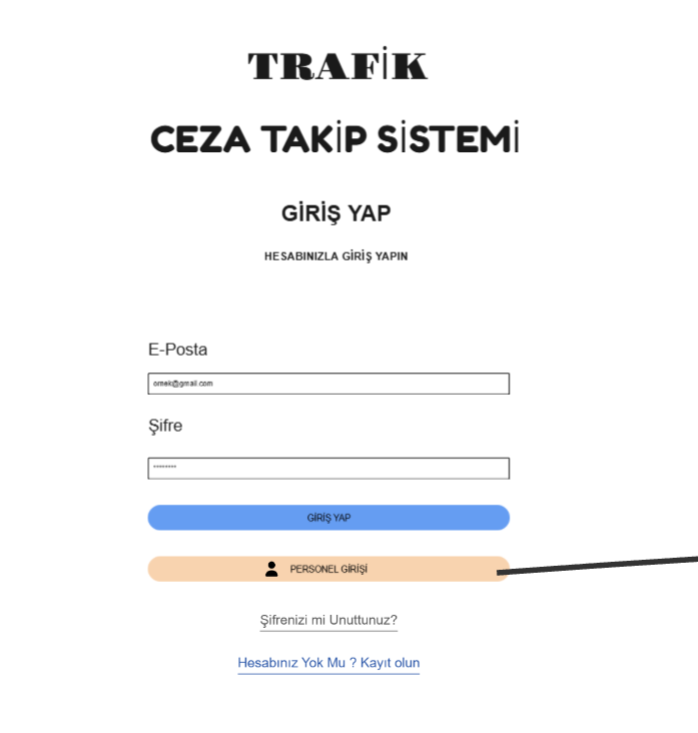 | 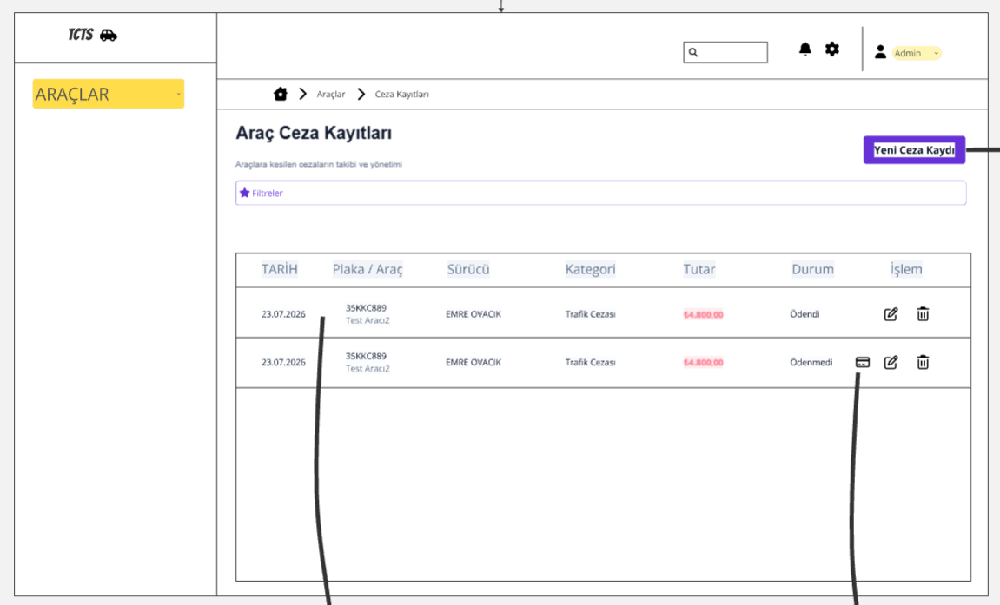 |

| Araç Ekle & Düzenle | Ceza Detay & Zaman Çizelgesi |
| :---: | :---: |
| 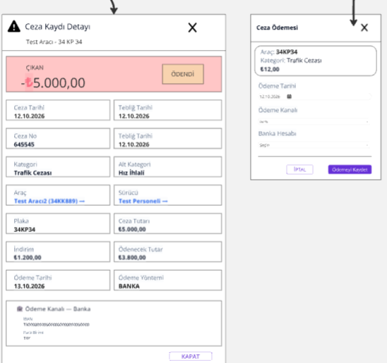 | 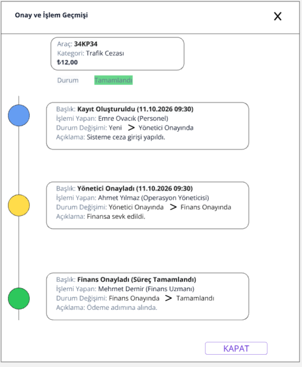 |

---

##  Uygulama İçi Ekran Görüntüleri ve Tasarım Uyumu

Sistem arayüzü, Miro üzerinde modellenen akış ve tasarım diline sadık kalınarak geliştirilmiştir.

### 1. Kimlik Doğrulama & Gösterge Paneli
| Giriş Ekranı | Araç Ceza Kayıtları (Dashboard) |
| :---: | :---: |
| 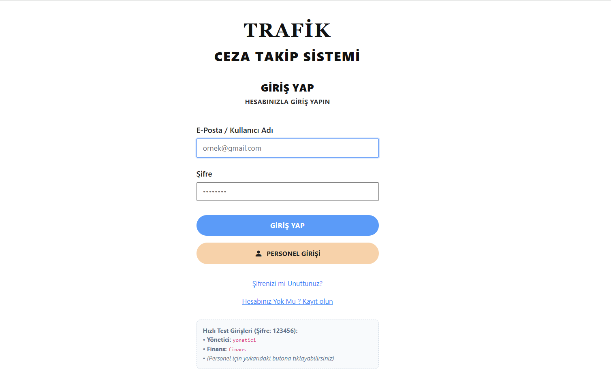 | 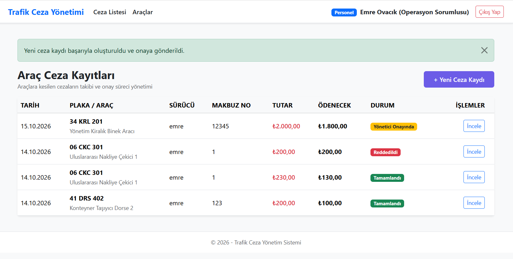 |

---

### 2. Araç Yönetimi (Filo & Detay Görünümleri)
| Araç Listesi | Yeni Ceza Kaydı Ekleme |
| :---: | :---: |
| 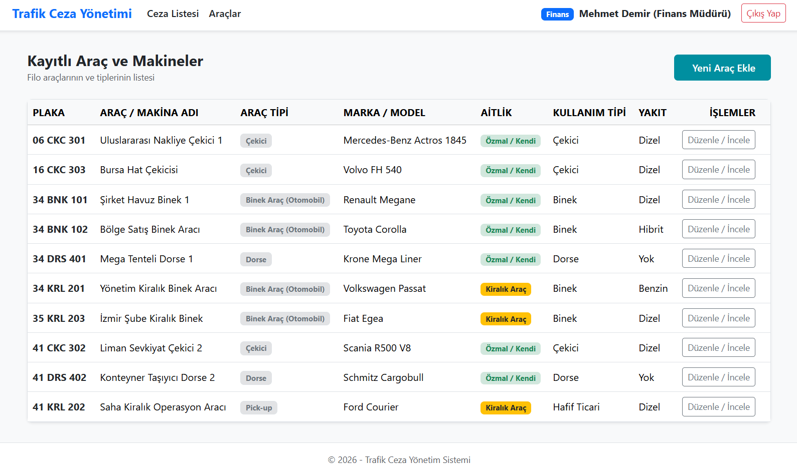 | 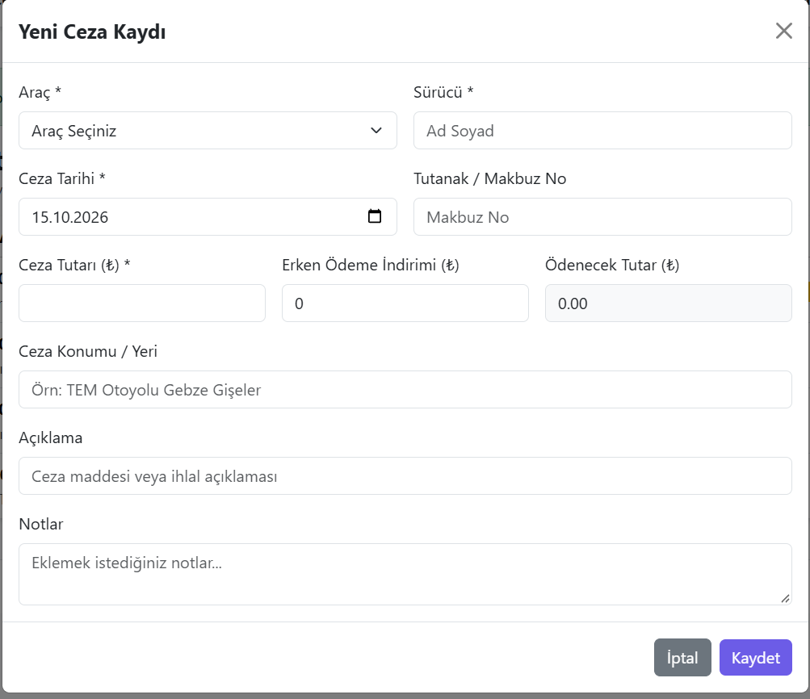 |

#### Araç Düzenleme ve Detay Formu (3 Aşamalı Görünüm)
| Genel Bilgiler | Sigorta ve Muayene | Satın Alma ve Kasko |
| :---: | :---: | :---: |
| 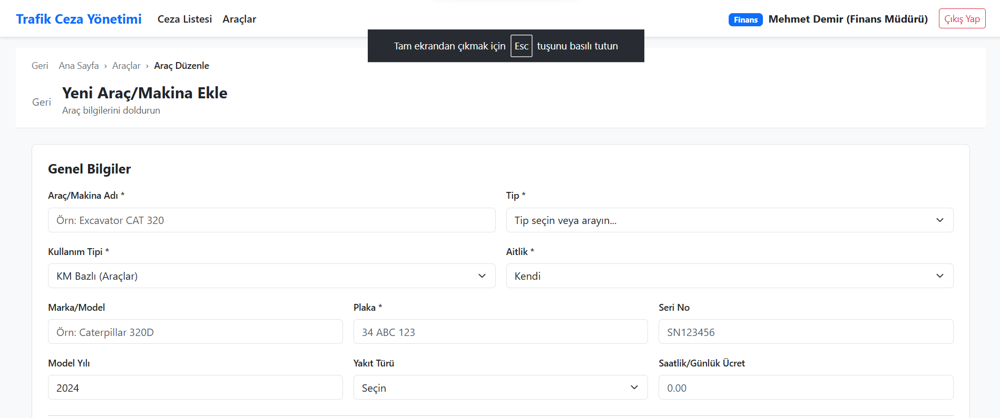 | 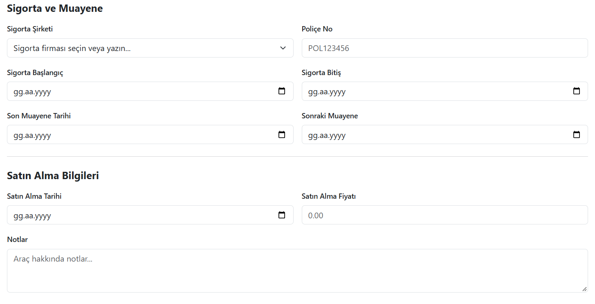 | 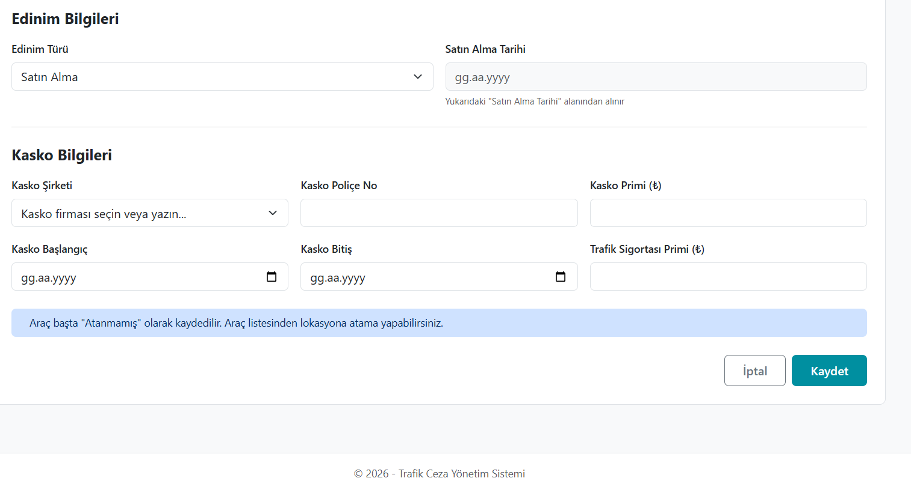 | | 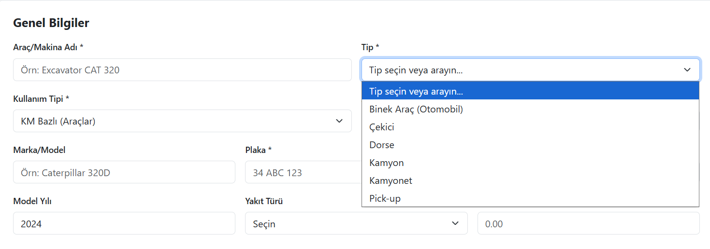 |

---

### 3. Çok Aşamalı Onay Mekanizması & Zaman Çizelgesi (Audit Log Timeline)
| Yönetici Onayı Aşaması | Finans Onayı & Tamamlanma | Ret Gerekçesi ve İptal |
| :---: | :---: | :---: |
| 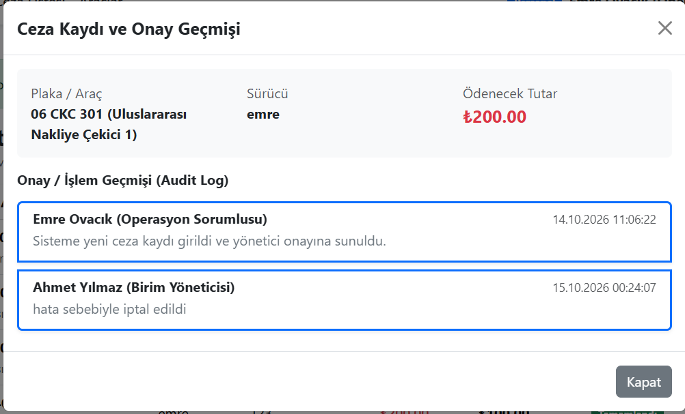 | 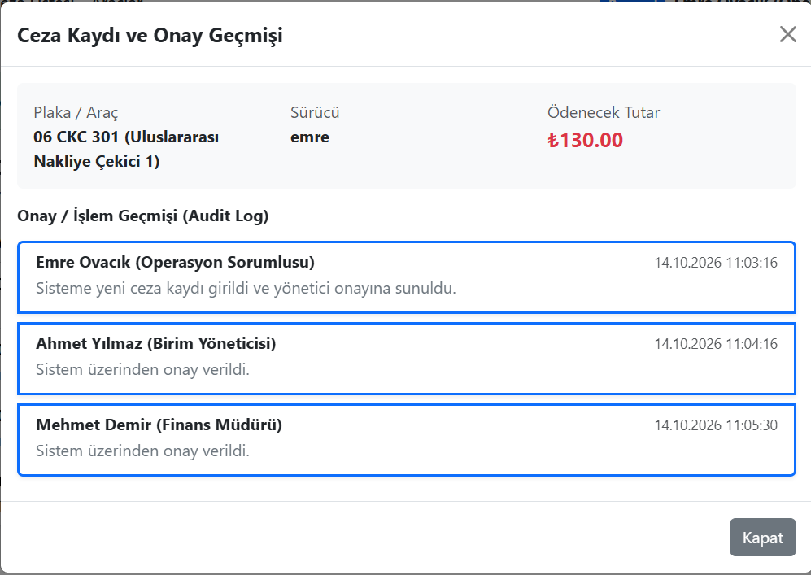 | 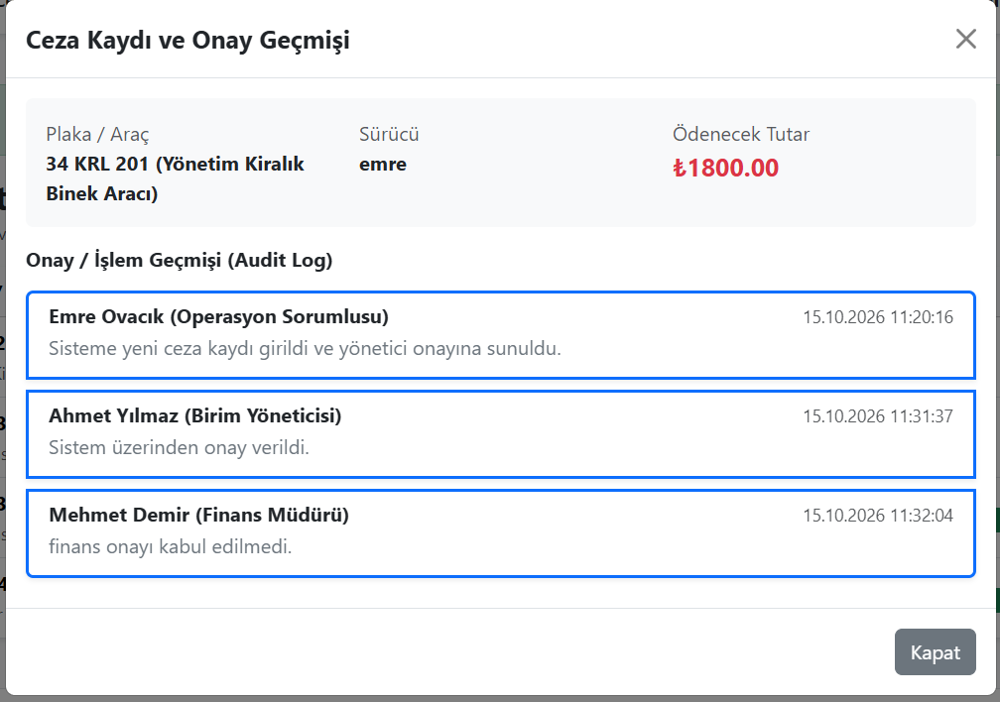 |

##  Kullanılan Teknolojiler

* **Çatı:** .NET Core MVC (C#)
* **Veritabanı & ORM:** SQL Server & Entity Framework Core (Code-First)
* **Kimlik Doğrulama:** Cookie-Based Authentication & Role-Based Authorization
* **Frontend:** Bootstrap 5.3 CDN, Bootstrap Icons, Custom CSS

---

##  Katmanlı Mimari (N-Tier)

```text
TrafikCezaYonetim/
├── TrafikCezaYonetim.Core/           # Varlıklar (Entities), Sabitler ve Enumlar
├── TrafikCezaYonetim.DataAccess/     # DbContext, Yapılandırmalar, Seed Data ve Migrations
├── TrafikCezaYonetim.Business/       # DTOlar, Validasyonlar, Servis Arayüzleri ve İş Mantığı
└── TrafikCezaYonetim.Web/            # MVC Controllerları, Viewlar ve UI Bileşenleri
```

---

##  Kurulum ve Çalıştırma

1. **Projeyi Klonlayın:**
   ```bash
   git clone [https://github.com/kullanici-adi/TrafikCezaYonetim.git](https://github.com/kullanici-adi/TrafikCezaYonetim.git)
   cd TrafikCezaYonetim
   ```

2. **Veritabanı Bağlantı Dizesini Belirleyin:**
   `TrafikCezaYonetim.Web/appsettings.json` dosyasını açıp yerel SQL Server bağlantınızı girin:
   ```json
   "ConnectionStrings": {
     "DefaultConnection": "Server=localhost;Database=TrafikCezaDb;Trusted_Connection=True;TrustServerCertificate=True;"
   }
   ```

3. **Veritabanını Oluşturun ve Migration'ları Uygulayın:**
   Package Manager Console üzerinden:
   ```shell
   Update-Database -Project TrafikCezaYonetim.DataAccess -StartupProject TrafikCezaYonetim.Web
   ```

4. **Projeyi Başlatın:**
   ```bash
   dotnet run --project TrafikCezaYonetim.Web
   ```

---

##  Ön Tanımlı Test Kullanıcıları

| Rol | Kullanıcı Adı | Şifre | Yetki Kapsamı |
| :--- | :--- | :--- | :--- |
| **Personel** | `personel` | `123456` | Yeni ceza kaydı açma, araç listesini inceleme |
| **Yönetici** | `yonetici` | `123456` | 1. Seviye Onay / Ret işlemleri |
| **Finans** | `finans` | `123456` | 2. Seviye Onay / Ret işlemleri ve Tamamlama |
